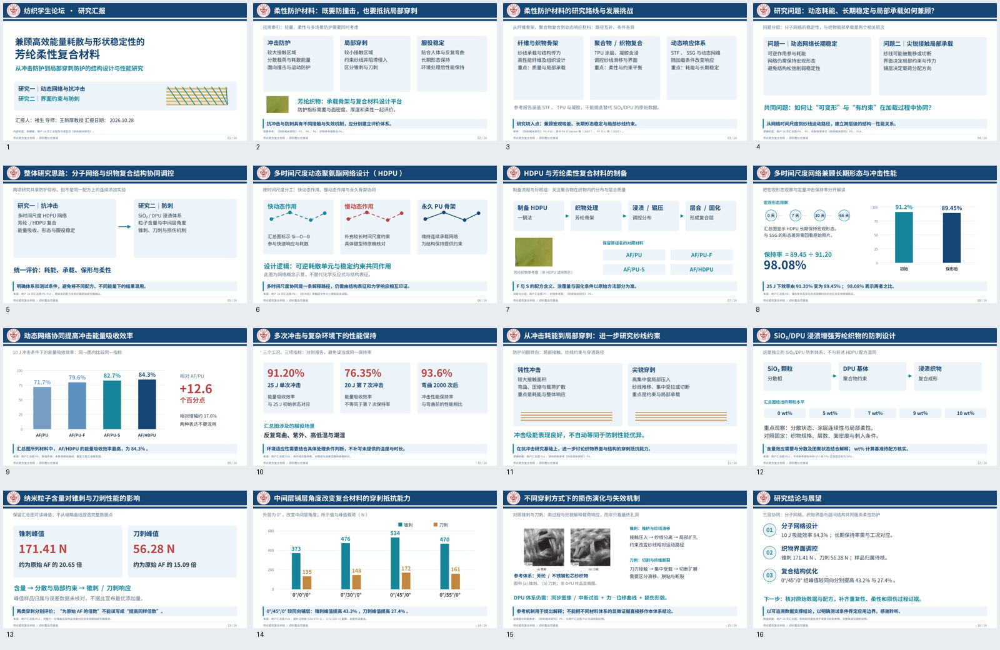

# 芳纶柔性复合材料｜16页完善版

按用户最新16页汇总图完善，建议讲述11分45秒，预留15秒用于换页。PPT内含16页演讲备注，采用手动翻页。

- [下载 PowerPoint](aramid_revised_16slides.pptx)
- [查看 PDF](aramid_revised_16slides.pdf)
- [逐页讲稿](speaker_notes_revised.md)
- [数据来源与核对说明](sources_and_data_checks.md)

本版已加入定量图表，并区分HDPU抗冲击与SiO₂/DPU防刺体系。数值主要转录自用户汇总图片；可读取的《防刺相关研究》用于研究背景及包芯纱损伤机制参照。三份超32 MiB的原始PPT尚未读取，具体限制及待核对项目见来源说明。未伪造完整实验曲线、误差线或最优添加量。
